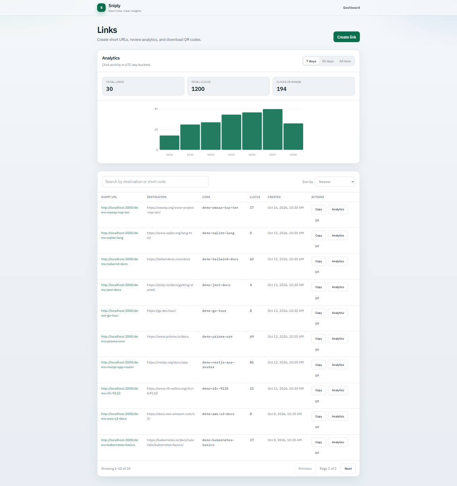
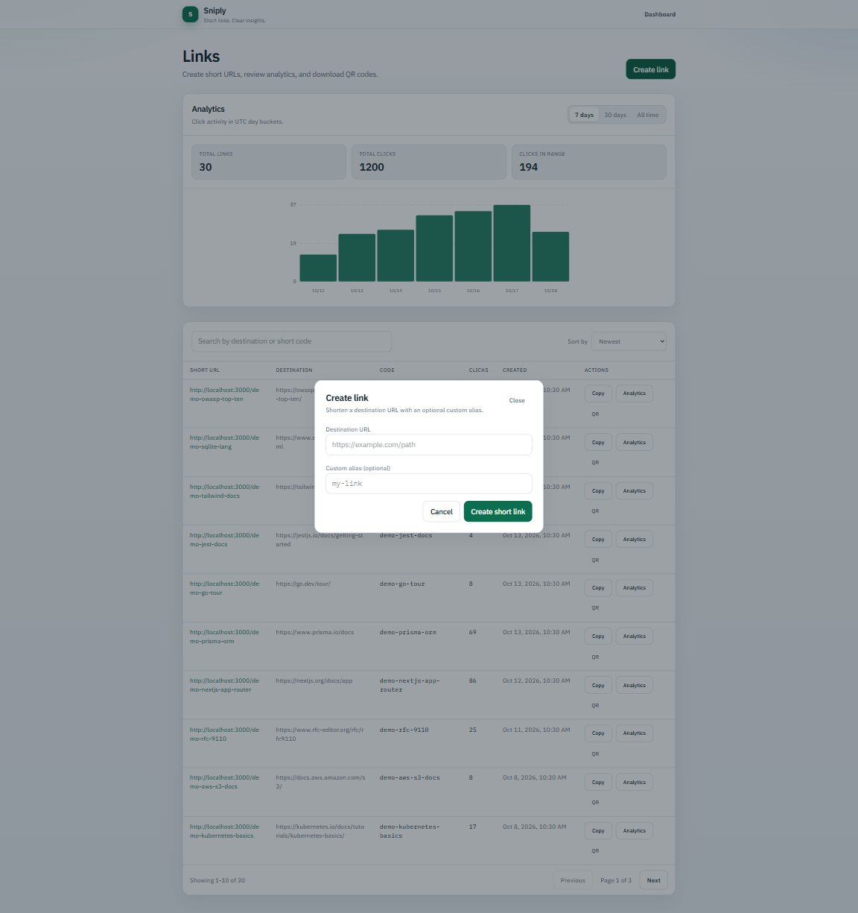
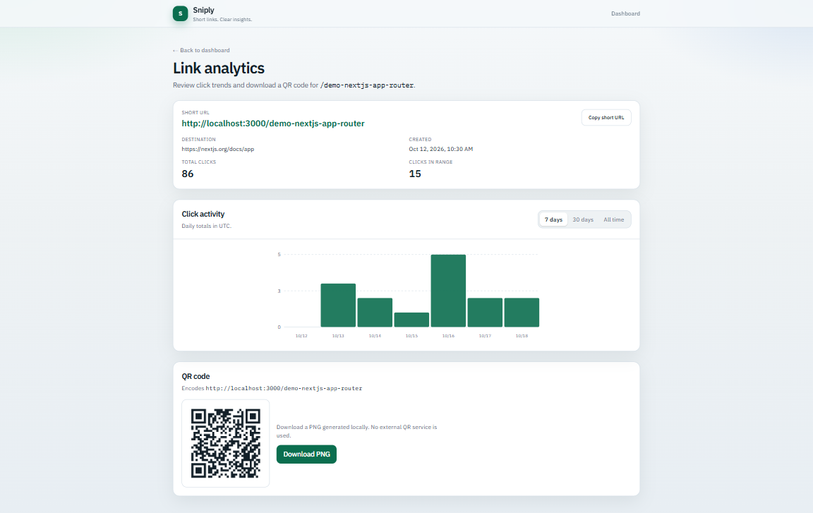

# Sniply

**Local-first URL shortener with click analytics and QR codes.**

Sniply is a self-contained portfolio project that demonstrates full-stack TypeScript engineering: secure link creation, PostgreSQL persistence, a responsive management dashboard, UTC click analytics, and locally generated QR codes.

> This project is intentionally **local-only**. It is **not deployed** and does not use hosting, paid cloud services, authentication providers, Redis, or Docker.

Repository: [github.com/devtdlv/sniply](https://github.com/devtdlv/sniply)

## Features

- Shorten HTTP(S) destinations with generated codes or optional custom aliases
- Reject unsafe schemes, credentials, localhost, and private/link-local targets (including DNS checks)
- Redirect short links with click recording
- Responsive dashboard: search, sort, pagination, create modal, copy-to-clipboard
- Analytics overview and per-link analytics with `7d` / `30d` / `all` filters
- UTC day-bucket click charts
- Local QR preview and PNG download (no external QR API)

## Tech stack

| Layer | Choice |
| --- | --- |
| Framework | Next.js 15 (App Router) |
| Language | TypeScript (strict) |
| UI | React 19, Tailwind CSS 4 |
| Database | PostgreSQL |
| ORM | Prisma 6 |
| Tests | Vitest |
| QR | `qrcode` (local) |
| Runtime | Node.js 24 LTS |

## Architecture overview

```text
Browser (dashboard + link pages)
        │
        ▼
Next.js App Router
  ├── UI routes: / , /links/[code]
  ├── Redirect:  /[code]  → 302 + Click insert
  └── JSON/PNG APIs under /api/*
        │
        ▼
Prisma Client
        │
        ▼
PostgreSQL
  ├── Link (code, destination, timestamps)
  └── Click (linkId, createdAt)
```

- Business rules live in `src/lib/` (`links`, `validate-url`, `analytics`, `qr`)
- Route handlers stay thin: parse input, call lib, return JSON or redirects
- Unit tests mock Prisma; they do not require a running database

### Analytics timezone

All analytics buckets use **UTC calendar days** (`YYYY-MM-DD`). API payloads include `"timezone": "UTC"`.

## Screenshots

### Dashboard

Link management, analytics overview, and demo data.



### Create Link

URL shortening with optional custom aliases.



### Link Analytics

Per-link click activity and QR code generation.



## Prerequisites

- Node.js 24 LTS (`engines.node` is `>=24.0.0`)
- npm 10+
- PostgreSQL 14+ running locally (18 is fine)

## Environment variables

Copy the example file and edit values. **Never commit `.env`.**

```powershell
Copy-Item .env.example .env
```

| Variable | Required | Description |
| --- | --- | --- |
| `DATABASE_URL` | Yes | PostgreSQL connection string for Prisma |
| `NEXT_PUBLIC_APP_URL` | Yes | Public origin for short URLs and QR payloads (no trailing slash), e.g. `http://localhost:3000` |

`.env.example` shows the shape only. Use your own local username, password, and database name.

## Local setup (Windows PowerShell)

### 1. Clone and install

```powershell
git clone https://github.com/devtdlv/sniply.git
cd sniply
npm install
```

### 2. Create the PostgreSQL database and role

Using `psql` as a superuser (adjust to your local admin setup):

```powershell
psql -U postgres -c "CREATE USER sniply_user WITH LOGIN PASSWORD 'choose-a-local-password';"
psql -U postgres -c "CREATE DATABASE sniply OWNER sniply_user;"
psql -U postgres -d sniply -c "GRANT ALL ON SCHEMA public TO sniply_user;"
```

Ensure the role has `LOGIN` and `CONNECT` on `sniply`.

### 3. Configure environment

```powershell
Copy-Item .env.example .env
notepad .env
```

Set `DATABASE_URL` and `NEXT_PUBLIC_APP_URL`.

### 4. Apply Prisma migrations

```powershell
npm run db:migrate:deploy
```

For schema iteration during development:

```powershell
npm run db:migrate
```

Check status:

```powershell
npx prisma migrate status
```

### 5. (Optional) Seed fictional demo data

For portfolio screenshots and manual UI testing, load a deterministic demo dataset:

```powershell
npm run db:seed:demo
```

What it inserts (fictional only):

- **30** demo links with `demo-` prefixed aliases (for example `demo-typescript-guide`, `demo-react-docs`)
- **1,200** demo click events spread across the last 30 UTC days, with varied traffic (popular, low, and some zero-click links)

Safety properties:

- Does **not** truncate, reset, or delete existing rows
- Skips any occupied code whose destination does not exactly match the demo plan
- Uses stable demo click IDs (`demo_clk_v1_...`) so re-running the command does not duplicate clicks
- Leaves non-demo / user-created links untouched

Re-run anytime; the second run should report links reused and clicks skipped as duplicates.

### 6. Run the app

```powershell
npm run dev
```

Open [http://localhost:3000](http://localhost:3000).

## Scripts

| Script | Purpose |
| --- | --- |
| `npm run dev` | Development server |
| `npm run build` | Production build |
| `npm run start` | Start production server |
| `npm run lint` | ESLint |
| `npm run typecheck` | `tsc --noEmit` |
| `npm test` | Vitest once |
| `npm run test:watch` | Vitest watch |
| `npm run db:generate` | Generate Prisma Client |
| `npm run db:migrate` | Create/apply migrations (dev) |
| `npm run db:migrate:deploy` | Apply migrations |
| `npm run db:migrate:status` | Migration status |
| `npm run db:seed:demo` | Insert fictional demo links/clicks (idempotent) |
| `npm run db:push` | Schema push without migration (legacy/emergency) |

## Testing

```powershell
npm test
npm run lint
npm run typecheck
npm run build
```

CI runs the same checks on push/PR to `main` via GitHub Actions (Node 24, `npm ci`). Tests mock the database and do not require PostgreSQL in CI.

## API summary

| Method | Path | Purpose |
| --- | --- | --- |
| `GET` | `/api/links` | Paginated list (`q`, `sort`, `page`, `pageSize`) |
| `POST` | `/api/links` | Create short link |
| `GET` | `/api/analytics` | Overview analytics (`range=7d\|30d\|all`) |
| `GET` | `/api/analytics/:code` | Per-link analytics |
| `GET` | `/api/links/:code/qr` | QR PNG download |
| `GET` | `/:code` | Redirect + record click |

Create body:

```json
{
  "destination": "https://example.com/path",
  "alias": "docs"
}
```

Common responses: `201` created, `400` validation, `404` missing/invalid code, `409` alias conflict, `500` generic server errors (no internal stack traces).

## Security considerations

- Destinations limited to `http:` / `https:`
- Credentials in URLs rejected
- Localhost, private, link-local, CGNAT, and metadata ranges blocked (literal IP and DNS-resolved)
- Destination URLs capped at 2048 characters
- Short-code path params validated before DB lookup (rejects reserved names and unsafe characters)
- Pagination `pageSize` capped at 50
- API error responses avoid leaking internal exception details
- No authentication: suitable for local portfolio demos only

Known residual risks:

- Destination servers may still redirect browsers to internal hosts after creation-time validation
- Obscure IP encodings / DNS rebinding after creation are not fully covered
- Anyone with local access can create and list links

## Project layout

```text
.github/workflows/ci.yml          CI: lint, typecheck, test, build
docs/screenshots/                 Screenshot instructions (+ PNGs when captured)
prisma/schema.prisma              Link + Click models
prisma/migrations/                Versioned SQL migrations
scripts/seed-demo.ts              Idempotent fictional demo-data seeder
src/app/                          App Router pages and API routes
src/components/                   Dashboard, analytics, QR UI
src/lib/                          Domain logic (includes demo-seed plan)
tests/                            Vitest suites
```

## Known limitations

- Local-first portfolio project; not deployed
- No authentication, billing, or multi-tenant isolation
- No referrer/device/geo analytics
- No edit/delete link management UI
- No Redis/Docker/hosting configuration by design

## License

Private portfolio repository unless otherwise stated by the owner.
